# Smart Hostel Management System — Unified Relational Database Architecture

## 1. Architecture Overview

- **Single Connection Pool:** Every module (`Auth`, `Outpass`, `Security Gate`, `Digital Attendance`, `Maintenance`, `Parcels`, `Circulars & Events`, `Mess Token Booking`, `Notifications`, `Audit`) shares one HikariCP pool (`HostelSharedHikariPool`) configured exclusively via `.env` / environment variables (`DB_HOST`, `DB_PORT`, `DB_NAME`, `DB_USER`, `DB_PASSWORD`, `DB_TIMEZONE`).
- **Timezone Contract:** Database connections and JVM run with `UTC` (`hibernate.jdbc.time_zone: UTC`). Business wall-clock windows (attendance deadlines, mess cutoff/QR-activation) resolve against `Asia/Kolkata` via `StatusConstants`, while frontend `ui.js` parses naive UTC timestamps and renders them in `Asia/Kolkata`.
- **Health Checks:** `DbHealthConfig` executes `SELECT 1` on boot and aborts startup if the database is unreachable; `GET /health` exposes public readiness telemetry.
- **Soft Delete Policy:** Deleting a user (`DELETE /api/admin/users/{id}`) or disabling status marks `is_active = false`, `status = 'disabled'`, and sets `deleted_at` across `users`, `students`, and `worker_profiles`. Inactive/deleted users are blocked at login/JWT verification and excluded from targeting/dropdowns while preserving historical records under `ON DELETE RESTRICT` foreign keys.

## 2. Entity-Relationship Diagram

```mermaid
erDiagram
    HOSTELS ||--o{ ROOMS : contains
    HOSTELS ||--o{ WARDEN_ASSIGNMENTS : assigns
    HOSTELS ||--o{ STUDENTS : houses
    ROOMS ||--o{ BEDS : has
    ROOMS ||--o{ STUDENTS : occupies
    ROOMS ||--o{ ROOM_REQUESTS : prefers
    ROOMS ||--o{ MAINTENANCE_REQUESTS : targets

    USERS ||--o| STUDENTS : profile_for
    USERS ||--o| STAFF_PROFILES : profile_for
    USERS ||--o| WORKER_PROFILES : profile_for
    USERS ||--o{ WARDEN_ASSIGNMENTS : assigned_warden
    USERS ||--o{ NOTIFICATIONS : receives
    USERS ||--o{ AUDIT_LOGS : performs
    USERS ||--o{ OUTPASS_SCAN_LOGS : scans
    USERS ||--o{ FILE_ATTACHMENTS : uploads

    STUDENTS ||--o| BEDS : assigned_to
    STUDENTS ||--o{ OUTPASSES : applies
    STUDENTS ||--o{ OUTPASS_LOCKS : locked_by
    STUDENTS ||--o{ ATTENDANCE_RECORDS : marks
    STUDENTS ||--o{ MAINTENANCE_REQUESTS : raises
    STUDENTS ||--o{ PARCELS : receives
    STUDENTS ||--o{ CIRCULAR_READS : acknowledges
    STUDENTS ||--o{ EVENT_RSVPS : responds
    STUDENTS ||--o{ MESS_TOKENS : books
    STUDENTS ||--o{ QR_TOKENS : owns

    OUTPASSES ||--o{ OUTPASS_SCAN_LOGS : logged_in
    OUTPASSES ||--o{ OUTPASS_LOCKS : blocks
    ATTENDANCE_SESSIONS ||--o{ ATTENDANCE_RECORDS : tracks
    ATTENDANCE_SESSIONS ||--o{ OUTPASS_LOCKS : triggers

    WORKER_PROFILES ||--o{ MAINTENANCE_REQUESTS : assigned_worker
    MAINTENANCE_REQUESTS ||--o{ REQUEST_STATUS_HISTORY : tracks
    MAINTENANCE_REQUESTS ||--o{ REQUEST_RATINGS : rated_by

    PARCELS ||--o| PARCEL_QR_TOKENS : uses
    PARCELS ||--o{ PARCEL_STATUS_HISTORY : tracks
    CIRCULARS ||--o{ CIRCULAR_TARGETS : scoped_to
    CIRCULARS ||--o{ CIRCULAR_READS : read_by
    CIRCULARS ||--o{ EVENT_RSVPS : rsvp_for

    FOOD_ITEMS ||--o{ MENU_SCHEDULE : scheduled_in
    MENU_SCHEDULE ||--o{ MESS_TOKEN_ITEMS : ordered_via
    MESS_TOKENS ||--o{ MESS_TOKEN_ITEMS : contains
    MESS_TOKENS ||--o| TOKEN_QR : verified_by
```

## 3. Data Dictionary (Core, Module & Shared Tables)

### Core Identity & Facility Tables

| Table | Purpose | Key Foreign Keys | Key Constraints & Indexes |
| --- | --- | --- | --- |
| `users` | Single Source of Truth for authentication, canonical `name`, `phone`, `role`, and lifecycle | — | `UNIQUE (email)`, `UNIQUE (register_number)`, `CHECK (status IN ('active','locked','disabled'))`, `idx_users_active_del` |
| `hostels` | Master hostel blocks/wings (`MAIN`, `FL1`, `FL2`) | — | `UNIQUE (code)`, `UNIQUE (name)`, `idx_hostels_active` |
| `rooms` | Physical rooms retained even after Room UI removal | `hostel_id -> hostels.id (RESTRICT)` | `UNIQUE (room_number)`, `CHECK (status IN ('active','maintenance'))`, `idx_rooms_hostel` |
| `beds` | Room beds mapped to active resident student | `room_id -> rooms.id`, `student_id -> students.id` | `UNIQUE (room_id, bed_number)`, `UNIQUE (student_id)` |
| `warden_assignments` | Links warden users to responsible hostels | `warden_user_id -> users.id (RESTRICT)`, `hostel_id -> hostels.id (RESTRICT)` | `UNIQUE (warden_user_id, hostel_id)` |
| `students` | Student profile, academic metadata, guardian info, current `hostel_id`/`room_id`, outpass lock state | `user_id -> users.id`, `hostel_id -> hostels.id`, `room_id -> rooms.id`, `unlocked_by_user_id -> users.id` | `UNIQUE (user_id)`, `UNIQUE (register_number)`, `UNIQUE (college_email)`, `idx_students_active_del` |
| `student_profiles` *(VIEW)* | Canonical relational projection of `students` (`roll_number`, `name`, `hostel_id`, `room_id`, guardian, active/deleted) | — | SQL `VIEW` over `students` |
| `staff_profiles` | Admin, Warden, and Security personnel metadata | `user_id -> users.id` | `UNIQUE (user_id)` |
| `worker_profiles` | Maintenance worker specialization, active & soft-delete flags | `user_id -> users.id` | `UNIQUE (user_id)`, `idx_worker_active_del` |

### Outpass & Security Gate Module

| Table | Purpose | Key Foreign Keys | Key Constraints & Indexes |
| --- | --- | --- | --- |
| `outpasses` | Outpass requests, approval metadata, gate exit timestamps | `student_id -> students.id`, `decided_by_user_id -> users.id` | `CHECK (status IN ('pending','approved','out','returned','rejected','expired'))`, `idx_outpasses_return_dt` |
| `outpass_scan_logs` | Security gate exit/entry/denied scan audit trail | `outpass_id -> outpasses.id (RESTRICT)`, `scanned_by_user_id -> users.id (RESTRICT)` | `CHECK (scan_action IN ('exit','entry','denied'))`, `idx_osl_outpass`, `idx_osl_scanned_at` |
| `outpass_locks` | Active & historical attendance-triggered outpass locks | `student_id -> students.id`, `outpass_id -> outpasses.id`, `attendance_session_id -> attendance_sessions.id`, `unlocked_by_user_id -> users.id` | `idx_ol_student_active (student_id, is_active)` |

### Digital Attendance Module

| Table | Purpose | Key Foreign Keys | Key Constraints & Indexes |
| --- | --- | --- | --- |
| `attendance_sessions` | Configured daily roll-call sessions & geofence parameters | `hostel_id -> hostels.id (RESTRICT)`, `created_by_user_id -> users.id` | `UNIQUE (name, hostel_block)`, `idx_att_sess_hostel` |
| `attendance_records` | Daily per-student per-session attendance marks & geolocation | `student_id -> students.id`, `session_id -> attendance_sessions.id`, `marked_by_user_id -> users.id` | `UNIQUE (student_id, session_id, attendance_date)`, `CHECK (status IN ('pending','marked','missed','on_outpass','manual_present'))` |
| `attendance_notifications_log` | Idempotency log for attendance reminders and missed locks | `student_id -> students.id`, `session_id -> attendance_sessions.id` | `UNIQUE (student_id, session_id, attendance_date, reminder_type)` |
| `outpass_lock_history` | Chronological lock/unlock/re-lock event log | `student_id -> students.id`, `session_id -> attendance_sessions.id`, `actor_user_id -> users.id` | `idx_olh_student` |

### Maintenance, Parcels, Circulars & Mess Modules

| Module | Tables | Shared Core Links & Constraints |
| --- | --- | --- |
| Maintenance | `maintenance_requests`, `request_attachments`, `request_status_history`, `request_ratings` | `student_id`, `assigned_worker_id -> worker_profiles.id`, `hostel_id`, `room_id`; `CHECK (status IN ('pending','assigned','in_progress','on_hold','completed','resolved','reopened','rejected','cancelled'))` |
| Parcels | `parcels`, `parcel_qr_tokens`, `parcel_status_history`, `parcel_attachments` | `student_id`, `hostel_id`, `received_by_user_id`, `delivered_by_user_id`; `CHECK (status IN ('received','notified','delivered','returned_to_sender','unclaimed','cancelled'))` |
| Circulars & Events | `circulars`, `circular_attachments`, `circular_targets`, `circular_reads`, `circular_versions`, `event_rsvps`, `circular_event_reminders` | `created_by_user_id`, `hostel_id`, `student_id`; `UNIQUE (circular_id, student_id)` on `circular_reads` & `event_rsvps`; `CHECK (status IN ('draft','scheduled','published','archived'))` |
| Mess Tokens | `food_items`, `mess_period_config`, `menu_schedule`, `mess_tokens`, `mess_token_items`, `token_qr`, `token_status_history` | `student_id`, `hostel_id`, `delivered_by_user_id`; `UNIQUE (food_item_id, menu_date, period)` on `menu_schedule`; `CHECK (status IN ('booked','qr_active','delivered','partially_delivered','cancelled','expired'))` |

### Unified Cross-Cutting Tables

| Table | Purpose | Key Foreign Keys & Constraints |
| --- | --- | --- |
| `notifications` | Single notification inbox across every module (`type`, `module`, `link`, `reference_type`, `reference_id`, `is_read`) | `user_id -> users.id`, `idx_notif_mod_ref` |
| `audit_logs` | Single security/compliance audit log (`actor_user_id`, `module`, `action`, `reference_id`, `old_value`, `new_value`) | `actor_user_id -> users.id`, `idx_audit_mod_ref` |
| `file_attachments` | Unified binary attachment metadata registry synced alongside legacy tables | `uploaded_by_user_id -> users.id (RESTRICT)`, `idx_fatt_mod_ent (module, entity_id)` |
| `qr_tokens` | Unified single-use HMAC-signed QR & 6-digit code registry (`PARCEL` and `MESS`) | `student_id -> students.id (RESTRICT)`, `UNIQUE (module, entity_id)`, `UNIQUE (qr_token)`, `UNIQUE (pickup_code)` |

